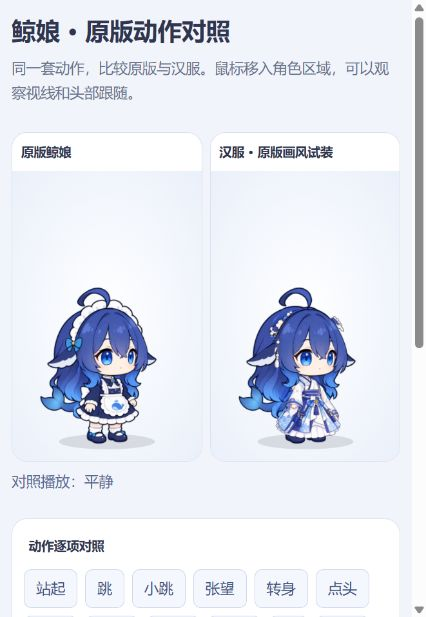

# 大肥鱼coopannion汉服dlc

> **AI 辅助制作 · 非官方同人皮肤 · 预览版 · 侵权立删**
>
> 本皮肤的新汉服及花饰素材由 AI 辅助生成、分层与调整，结合原项目代码和素材制作，不代表纯手绘或官方作品。原角色、素材与代码的权利及署名归相应权利人所有。
>
> **侵权立删：**如权利人认为本项目涉及侵权，请通过仓库 Issues 提供涉及内容及权属说明；收到通知后将及时核查并下架相关内容。此声明不替代授权或许可证义务。

标签：`ai-assisted` · `ai-generated-assets` · `fan-made` · `unofficial` · `coopanion` · `hanfu` · `desktop-pet`

Coopanion 桌宠独立汉服皮肤，版本 **0.1.0 预览版**。

## 安装

下载皮肤 ZIP，在 Coopanion 的皮肤/换装页面选择「导入」，选择 ZIP 后安装「大肥鱼coopannion汉服dlc」，再从皮肤列表选择它。使用支持 figure manifest/API 2 的新版 Coopanion。请不要直接覆盖软件的 node_modules 或内置 whale 文件夹。

## 功能

- 白蓝汉服、花饰和流苏。
- 18 个原版动作、19 种原版表情。
- 原版眼睛、眉毛、口型、头发、尾巴、鲸鳍与呆毛动态。
- 衣袖柔性弯曲和延迟回弹，花饰流苏独立跟随。
- 独立皮肤 ID，安装在用户皮肤目录。

## 当前限制

这是可安装的试装版本。坐姿裙摆暂用变形，尚未独立补绘；大幅挥手的宽袖遮挡、花饰边缘、服装阴影仍需精修。汉服素材来自 AI 辅助分层，不是三视图的精确拆分或官方服装。本项目为社区衍生皮肤，与原项目无官方关联。

## 文件

`figure.json` 是皮肤入口清单，`entry.js` 负责加载，`hanfu-model.json` 是图层与动作配置，`layers/` 保留分层素材，`native/` 保留所复用的渲染代码和原版素材。全部运行代码随包提供，无屏幕读取、录音、联网识曲或账号配置。

## 来源和许可

基于 [Pal-AI-Lab/Coopanion](https://github.com/Pal-AI-Lab/Coopanion) 的 cortico-world-desktop-pet 0.2.0。原程序作者 Pal AI Lab；角色原设：溟月（上善无形）；DeepSeek 女仆二创：ZipZipPipe。相关原始署名也保留在 native/whale/figure.json 中。

复用代码按 AGPL-3.0-or-later 发布，完整许可证见 LICENSE。修改包括汉服图层配置、独立入口、柔性袖摆和说明文档。原角色及第三方素材的权利属于各自权利人；软件许可证不代表对角色商标或第三方素材另行授予权利。分享衍生版本时，请保留署名、许可证和对应源代码。

